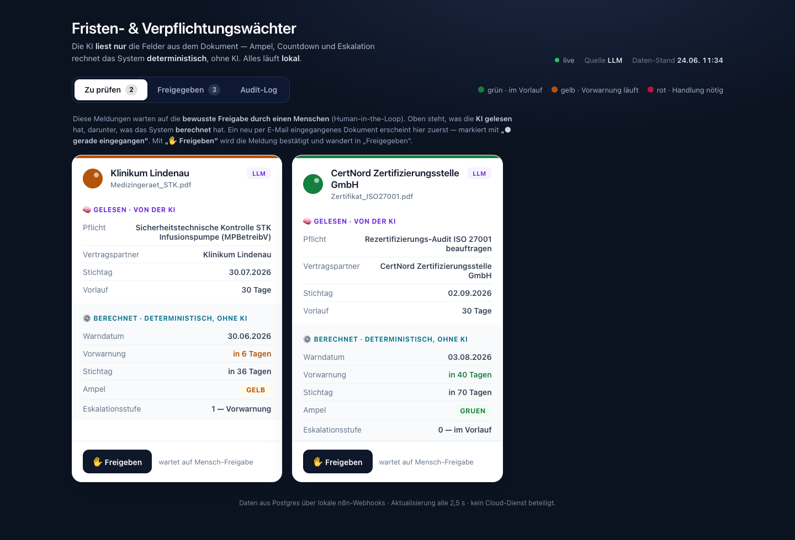
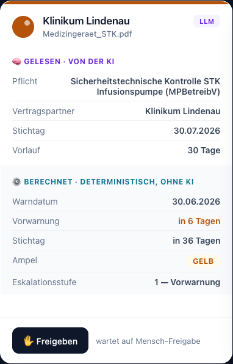
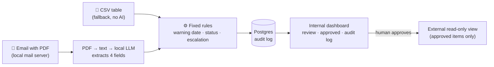
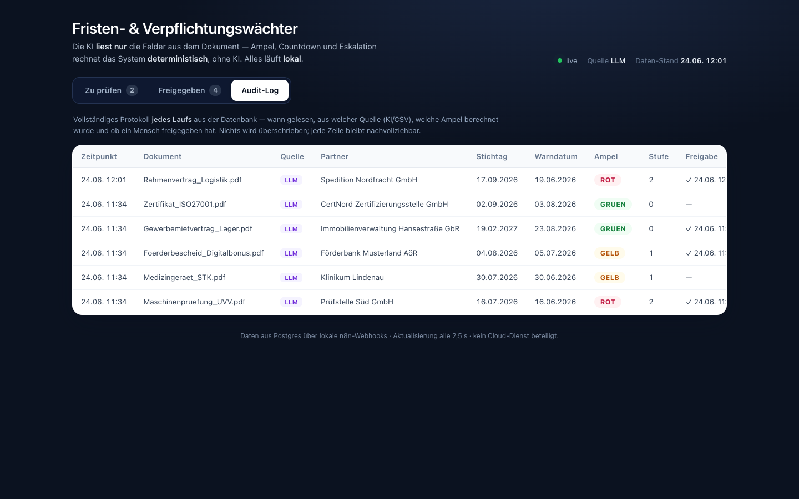
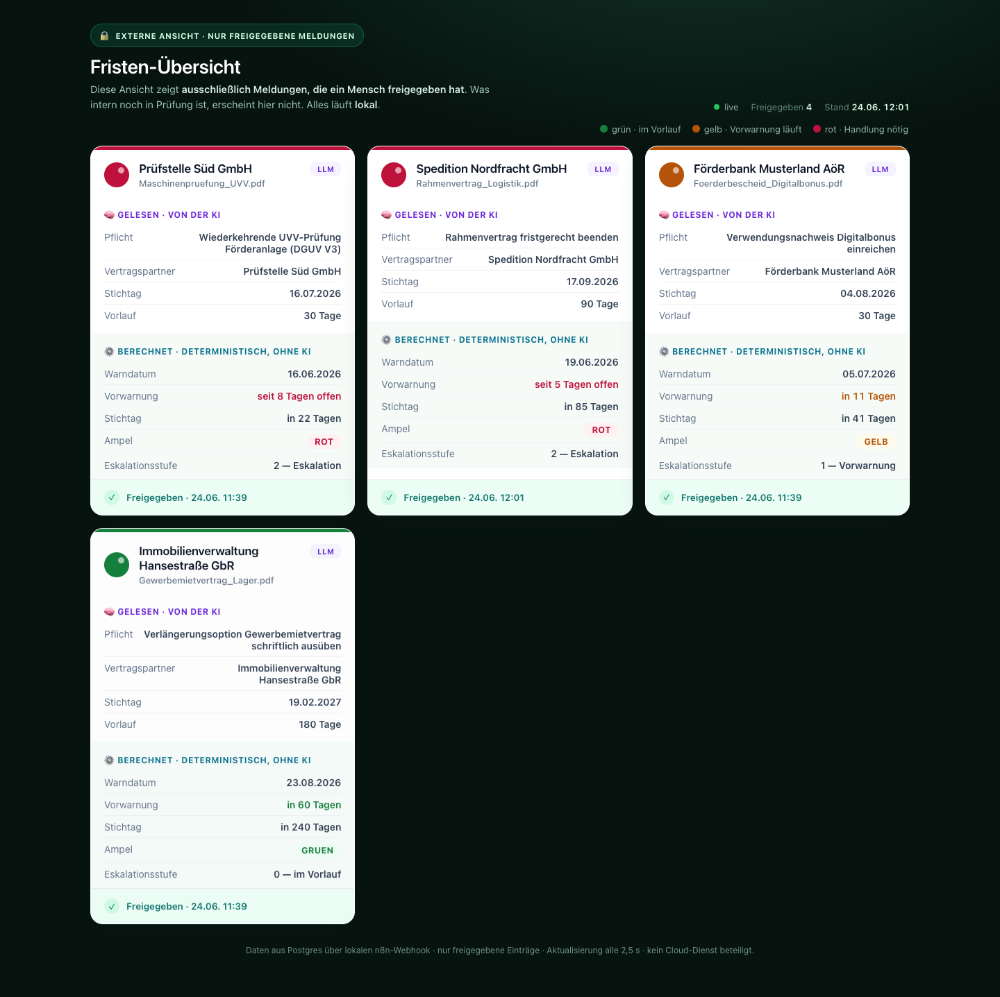

# AI Deadline Monitor

**A fully local AI workflow that reads contracts and compliance documents, finds the deadlines hidden in them, and turns each one into a red / amber / green status with an escalation level, without a single byte leaving the machine.**

*German name: Fristen- & Verpflichtungswächter.*

**My role:** I designed and built it end to end (architecture, n8n workflows, rule engine, dashboards, test data, accuracy benchmark) in June 2026, with Claude Code as AI pair programmer.

> **Featured:** used as the demo in a talk on AI workflow automation at the Q-FOX® Group AI event
> *„AI verändert rasant den Markt – Wie Unternehmen jetzt Potenziale erschließen“* (Germany, 3 July 2026).



*Screenshots show the seeded demo board (German UI). On pre-seeded cards, partner and obligation are set to the human-checked values, which is the correction the approval step exists for.*

---

## The problem

Companies miss deadlines that are buried in documents: contract cancellation windows, machine inspection dates, medical-device safety checks, certification audits, funding reporting dates. They sit in PDFs and letters, not in a system, so someone has to remember them. When nobody does, a contract renews for another year or an inspection lapses.

Off-the-shelf tools rarely help here. CRM and helpdesk suites work on fixed rules (keywords, senders) inside their own ecosystem, and most small and mid-sized companies don't have one integrated system anyway.

## The core idea: the AI reads, the system calculates

The part that has to be trustworthy is kept away from the AI.

| Step | Who does it | Why |
|---|---|---|
| Read the document and pull out 4 fields: **partner**, **deadline**, **lead time in days**, **obligation** | A small **local LLM** | Understanding free text is what language models are good at |
| Compute the warning date, days remaining, traffic-light status and escalation level | **Fixed rules, no AI** | Same input → always the same result. Explainable to a CEO or an auditor |
| Confirm the alert | **A human** (one click) | Catches the rare reading error before anything escalates |

The rules are deliberately simple:

- **Warning date** = deadline − lead time (the lead time comes from the document itself, e.g. "3 months' notice")
- **Red, escalation level 2:** the warning date has been reached → action needed now
- **Amber, level 1:** the warning date is at most 14 days away
- **Green, level 0:** more than 14 days left



## Measured accuracy

The extraction was measured against a known answer key: **10 synthetic German documents from 10 different industries** (logistics, machine inspection, medical devices, public funding, insurance, commercial lease, ISO certification, fleet leasing, fire safety, calibration).

| Field | Correct | Rate |
|---|---|---|
| **Deadline** (the date everything is calculated from) | 10/10 | **100%** |
| **Lead time** (days) | 10/10 | **100%** |
| Contract partner | 8/10 | 80% |
| Valid JSON output | 10/10 | 100% |
| **All key fields** | **28/30** | **93%** |

Model: `llama3.2:3b`, running locally through Ollama on an 8 GB Apple M2 (about 2.5 s per document). Both misses are the same pattern: a German special character in a company name (*Süd* read as *Söd*, *Hansestraße* garbled). That is exactly why there is a human approval step and a CSV fallback. Method and reproduction: [`docs/accuracy-benchmark.md`](docs/accuracy-benchmark.md) (German). This is a demo-scale measurement, not a production benchmark.

## How it works



- **Three ways in, one rule engine.** An email with a PDF attachment (AI reads it), a folder of PDFs (AI reads it), or a CSV table (no AI). All three feed the same AI-free rules.
- **CSV fallback with one setting** (`mode = llm | csv`). If the language model misbehaves on demo day, the deadlines come from a table instead and everything downstream works the same.
- **Human in the loop.** Every alert waits in "To review" until a person clicks *Approve*.
- **Audit log.** Every run is written to Postgres as a new row: when it was read, from which source (AI or CSV), which status was calculated, and whether and when a human approved it. Approval only adds a flag and a timestamp.
- **External view.** A separate read-only page shows only what a human has approved. Internally you see everything; outside, only what was released.





## Privacy: local by design, not by claim

Everything runs on one machine: the documents, the language model, the database and even the mailbox. There is no cloud LLM anywhere in the data path. n8n's default telemetry was found during a security review and switched off, so the "nothing leaves the machine" claim is actually true.

## Tech stack

| Component | Choice | Role |
|---|---|---|
| Orchestration | **n8n** (self-hosted, Docker) | Runs the workflows and serves the dashboards |
| Language model | **Ollama** + `llama3.2:3b` (native on the Mac for GPU access) | Field extraction only |
| Database | **PostgreSQL 16** (Docker) | Audit log and data source for the dashboards |
| Mail | **GreenMail** (Docker) | Local SMTP/IMAP test server, so the email path never leaves the machine either |
| Frontend | Plain HTML/JS (two pages) | Internal dashboard + external read-only view |
| Setup | **Docker Compose** | One command brings up the stack |

## Quick start (macOS, Apple Silicon)

```bash
# 1. Prerequisites: Docker Desktop (open it once after installing) and Ollama
brew install --cask docker
brew install ollama && brew services start ollama
ollama pull llama3.2:3b

# 2. Get the code and configure it
git clone https://github.com/stepan-fil/ai-deadline-monitor.git && cd ai-deadline-monitor
cp .env.example .env        # set POSTGRES_PASSWORD and N8N_ENCRYPTION_KEY (e.g. openssl rand -hex 24)

# 3. Re-date the demo documents relative to today (otherwise every deadline is already red)
python3 -m venv .venv && .venv/bin/pip install reportlab
.venv/bin/python testdata/build_pdfs.py

# 4. Start n8n + Postgres + the local mail server
docker compose up -d
open http://localhost:5678  # create the local n8n owner account (stays on your machine)
```

Then, in n8n: add a Postgres credential (host `postgres`, database and user `fristenwaechter`, password from `.env`), import the three workflows from `n8n/`, activate the dashboard workflow, and run the CSV workflow once. The board is at `http://localhost:5678/webhook/dashboard`. The full step-by-step guide, including the email path and troubleshooting, is in [`SETUP.md`](SETUP.md) (German).

## Repository structure

```
├─ docker-compose.yml      n8n + Postgres + GreenMail (Ollama runs natively)
├─ .env.example            configuration template (no real secrets)
├─ db/init.sql             Postgres schema (audit_log)
├─ n8n/                    the three workflows (CSV intake, mail intake, dashboard server) + build script
├─ dashboard/              internal dashboard + external read-only view (HTML)
├─ testdata/               10 synthetic PDFs, the CSV answer key, PDF generator, demo/mail scripts
├─ scripts/extract_test.py accuracy measurement (LLM output vs. answer key)
├─ docs/                   accuracy benchmark + screenshots
└─ SETUP.md                full installation guide (German)
```

## Design decisions worth knowing

- **Smallest model that does the job.** A larger model overloaded an 8 GB machine. Reading four fields doesn't need one; a 3B model gets the dates 100% right.
- **Safe path first.** The deterministic engine and the CSV path were built and demo-ready before the AI was added, so the backup existed from day one.
- **Pinned versions.** n8n is pinned to a fixed version so an update can't break the demo.
- **Multi-angle reviews.** After every milestone, separate review passes checked the technical design, fit with the brief, demo realism, QA and security/leaks.

## Limitations (honest)

- **Demo scale.** 10 synthetic documents are a proof of concept, not a production benchmark.
- **No scheduled reminders yet.** Urgency is calculated when a document comes in and shown on the dashboard; a daily re-check with email/Slack notifications is the obvious next step.
- **German documents and UI**, since it was built for a German-speaking audience.
- **Small-model quirks.** Umlauts in proper names are occasionally misread; the approval step exists for exactly this.

## How it was built

Designed and built by **Stepan Filazafovitch** in June 2026, with Claude Code as the AI pair programmer. The project was planned as milestones, every decision was logged, and each step was checked by independent review agents before moving on.

[LinkedIn](https://www.linkedin.com/in/stepan-filazafovitch-8562bb262/)

## License

[MIT](LICENSE)
